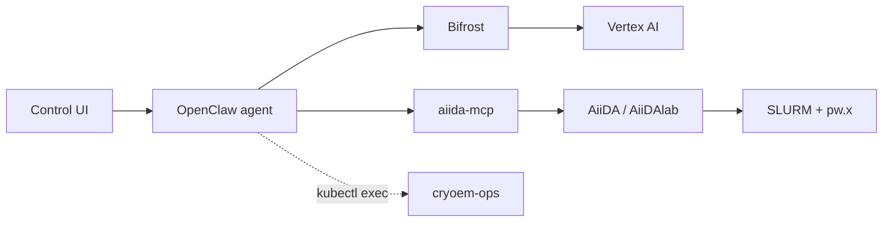

**THIS IS SLOP I MADE FOR A TECH DEMO, BEWARE!!!**

# AiiDAlab + OpenClaw demo

One machine, one k3s node, an OpenClaw agent wired to AiiDAlab and AiiDA, a
rootless SLURM cluster with Quantum ESPRESSO, a CPU cryo-EM pod, and Bifrost in
front of Vertex AI. A NixOS module installs all of it, including k3s.



The agent submits a `pw.x` calculation through AiiDA, follows it through SLURM,
reads the result, and writes a notebook into AiiDAlab. Cryo-EM tools run in the
foreground of the cryo-EM pod, without AiiDA. I built it to watch an agent work
on a cluster instead of a mock.

## Requirements

- NixOS with flakes, and Docker enabled on the host (two images build with it).
- About 20 GB free. The claims request 206 GiB but are thin on `local-path`.
- Tens of minutes on the first activation. The AiiDAlab image installs three
    Python environments and the cryo-EM image installs RELION.
- A Google Cloud project with Vertex AI enabled and application default
    credentials. `vertex.project` is required.
- A reachable node address for the Kubernetes API path.

## Install

Add the flake input, import `nixosModules.default`, and set:

```nix
services.aiidalab-openclaw-demo = {
    enable = true;
    nodeAddress = "192.0.2.10";
    vertex.project = "my-gcp-project";
};
```

`storageClass` and `secretsFile` have defaults. Write the dotenv from
`secrets.env.example` before switching, then:

```bash
sudo nixos-rebuild switch --flake .#demo
```

Port-forward the control UI:

```bash
sudo k3s kubectl -n openclaw port-forward svc/openclaw 18789:18789
```

The first switch builds four images and applies the manifests.

## Security

No ingress by default. Services are `ClusterIP`, Traefik and ServiceLB are
disabled, and the Cloudflare edge is off unless you enable it. Every namespace is
default-deny on ingress and egress and runs the restricted Pod Security Standard.
The agent may only `get` pods and `create pods/exec` on three named pods. Secrets
stay in the root-only dotenv named by `secretsFile`.

## Docs

- [docs/architecture.md](docs/architecture.md): components, namespaces, diagrams,
    delivery chain, policy.
- [docs/install.md](docs/install.md): options, verify, first-run notes.
- [docs/provisioning.md](docs/provisioning.md): secret values, Bifrost key,
    export CronJob, edge.
