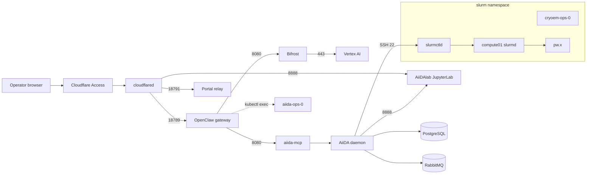
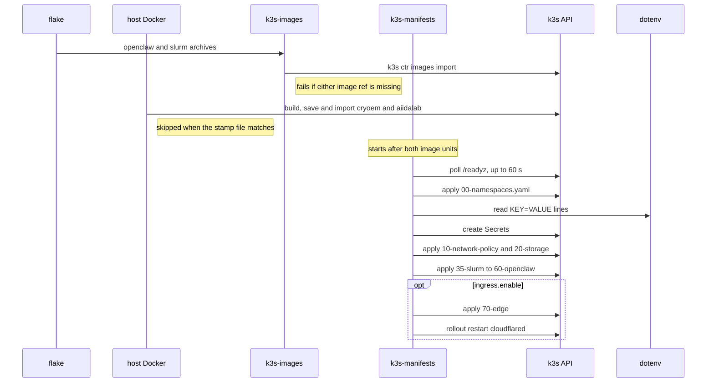
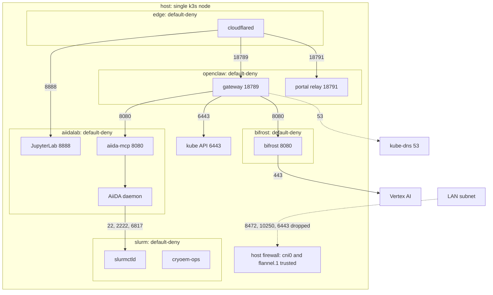

# Architecture

The module owns a single-node k3s cluster on the host and installs the whole
demo into it. This file describes what runs where, how a request travels, how
the cluster is delivered, and what the policy layer allows.

## Component map

### Namespaces

| Namespace | Purpose |
|---|---|
| `openclaw` | Agent gateway, control UI, portal relay |
| `aiidalab` | PostgreSQL, RabbitMQ, JupyterLab, AiiDA daemon, MCP server, ops pod |
| `slurm` | SLURM controller, one compute node, cryo-EM submit host |
| `bifrost` | Model gateway in front of Vertex AI |
| `edge` | Optional Cloudflare tunnel connector |

All five carry `pod-security.kubernetes.io/enforce=restricted` plus the audit and
warn labels. Every namespace starts from a default-deny ingress and egress
policy; the allow rules are explicit.

### `openclaw`

| Object | Notes |
|---|---|
| Deployment `openclaw` | Two containers: `gateway` (port 18789) and `portal-bridge` (18791, relays the gateway's loopback portal listener). Two init containers seed the Nix store and create the state directories |
| Service `openclaw` | ClusterIP. `18789` to the gateway; `18790` to the portal-bridge on pod port 18791 |
| ConfigMap `openclaw-config` | `openclaw.json`: model catalogue, MCP server, gateway auth, browser SSRF allowlist |
| ConfigMaps `openclaw-skills`, `openclaw-cluster-skills` | Skill documents projected at `/etc/openclaw/skills` |
| ServiceAccount + Roles `openclaw-ops` | `get` pod and `create pods/exec` on three named pods only |
| Secrets `openclaw-gateway`, `bifrost-vk`, `aiida-mcp-client` | Control UI password, Bifrost virtual key, MCP bearer token |
| PVCs `openclaw-state` (20 Gi), `openclaw-nix` (64 Gi) | `/srv/openclaw` and `/nix` |

The gateway image carries its own Nix store. Because the `openclaw-nix` claim
mounts over `/nix`, an init container seeds the claim from the image store and
the gateway container loads the store registration at start. The agent therefore
has a writable Nix store for throwaway tooling.

### `aiidalab`

| Object | Notes |
|---|---|
| StatefulSet `aiidalab-postgres` | PostgreSQL 17.6, uid 999, PVC 20 Gi, user `aiida`, database `aiidadb` |
| StatefulSet `aiidalab-rabbitmq` | RabbitMQ 4.1.4, uid 999, PVC 5 Gi |
| Deployment `aiidalab-jupyter` | JupyterLab with the AiiDA profile, port 8888, PVC `aiidalab-home` 30 Gi |
| Deployment `aiida-daemon` | `verdi daemon start --foreground 1`; mounts the SLURM key at `/etc/slurm-key` and nowhere else |
| StatefulSet `aiida-ops` | Idle pod `aiida-ops-0` for read-only CLI work over `kubectl exec` |
| Deployment `aiida-mcp` | `front.py` (bearer token, port 8080) in front of `mcp-proxy` (8081) in front of `server.py` |
| ConfigMaps `aiida-mcp-code`, `aiida-tools`, `aiida-slurm-override` | MCP server and tool sources, retrieved-file exporter, scheduler override |
| Job `aiidalab-bootstrap-<hash>` | Idempotent profile, computer, code and pseudopotential setup |
| CronJob `files-export` | Held by default; exports retrieved files to `notebooks/<pk>-files/` |

The bootstrap job creates the AiiDA profile `aiidalab`, the computer
`slurm-local` (SSH + SLURM to the `slurm` namespace), one code per installed
Quantum ESPRESSO executable, and the SSSP 1.3 PBE/efficiency family from an
archive baked into the image. It needs no network.

`aiida-slurm-override` ships a `sitecustomize.py` that forces
`import_sys_environment = False` on every submit script. A rootless `slurmd`
cannot honour `--get-user-env`, and AiiDA emits it by default.

### `slurm`

| Object | Notes |
|---|---|
| StatefulSet `slurmctld` | `munged` (uid 998), `slurmctld` (uid 1000), `sshd` (uid 1000, in-pod port 2222) |
| Deployment `slurmd` | Hostname fixed to `compute01`; `munged`, `slurmd` (uid 1000), `node-reconciler` |
| StatefulSet `cryoem-ops` | CPU cryo-EM submit host, uid 1000, PVC `cryoem-scratch` 50 Gi |
| Services `slurm`, `slurmctld`, `slurmd` | `slurm` maps 22 to 2222 and exposes 6817; the other two are headless and publish not-ready addresses |
| Job `slurm-selftest` | Proves munge, node registration, dispatch, completion and `pw.x` presence |
| PVCs `slurm-state` (2 Gi), `slurm-scratch` (10 Gi) | Controller state and shared job scratch |

`slurm.conf` defines cluster `sandbox`, node `compute01` (8 CPUs, 15000 MB) and
partitions `debug` and `batch`. `SlurmUser` and `SlurmdUser` are both `aiida`,
so no process in the namespace needs root, a setuid binary or a privileged
port. `proctrack/linuxproc` replaces `proctrack/pgid`, and `CgroupPlugin` is
disabled, both because the rootless daemons cannot use the default mechanisms.

Two sidecars keep the daemons alive across restarts. `munged-supervisor.sh`
restarts `munged` when the mounted munge key changes, in both pods. The
`node-reconciler` points the controller at the compute pod's current address and
resumes a node that is not usable.

### `bifrost`

| Object | Notes |
|---|---|
| Deployment `bifrost` | Digest-pinned upstream image, uid 1000, port 8080, PVC `bifrost-state` 5 Gi |
| ConfigMap `bifrost-config` | `config.json`, region and model constants, local pricing datasheets |
| Service `bifrost` | ClusterIP, port 8080 |
| Secrets `vertex-credentials`, `bifrost-setup` | Vertex ADC JSON at `/etc/gcp/credentials.json`, setup token |
| Job `bifrost-selftest` | Created suspended; run it by hand |

Bifrost reads `config.json` at every boot and resolves
`google.FindDefaultCredentials()`, so the ADC file is the only credential it
needs. Pricing and model-parameter data come from files in the same ConfigMap,
so the gateway boots without internet access.

### `edge`

Opt-in, and empty when disabled: with `ingress.enable = false` the module drops
the whole `70-edge` directory before applying anything. When enabled it applies
a two-replica `cloudflared` Deployment and a ConfigMap whose only ingress rule
is a catch-all 502. Serving real hostnames is a separate, explicit step
described in [provisioning.md](provisioning.md).

## Data flow

The diagram shows the request paths between the components. The notes below add
the mechanics.



1. **Operator to control UI.** A browser reaches `openclaw:18789` through a
    port-forward, or through `cloudflared` when the edge is open. The gateway
    asks for the password in `openclaw-gateway`.
2. **Agent to models and AiiDA.** OpenClaw calls Bifrost at
    `http://bifrost.bifrost.svc.cluster.local:8080/v1` with the virtual key from
    `bifrost-vk`; Bifrost resolves Vertex credentials and calls the regional
    Vertex endpoint on 443. For AiiDA it calls
    `http://aiida-mcp.aiidalab.svc.cluster.local:8080/mcp` with the bearer token
    from `aiida-mcp-client`. `front.py` checks the token, `mcp-proxy` forwards to
    the stdio server, and the server submits the process spec.
3. **AiiDA to SLURM.** The daemon uploads the job over SSH to
    `aiida@slurm.slurm.svc.cluster.local:22`, which lands on the controller
    pod's sshd at 2222. `sbatch` talks to `slurmctld` on 6817, which dispatches
    to `slurmd` on 6818. `pw.x` runs as uid 1000 and writes into `/scratch/aiida`.
4. **Results back.** The daemon retrieves files into the AiiDA repository on the
    home claim. The MCP server writes a reproduction notebook through the Jupyter
    contents API on 8888, so the notebook appears in the AiiDAlab file browser
    under `notebooks/`.
5. **Direct CLI work.** The agent runs `kubectl exec` into `aiida-ops-0`,
    `slurmctld-0` or `cryoem-ops-0`. The request goes to the Kubernetes API on
    the node address, and the API server opens the exec stream.

Cryo-EM work skips AiiDA: the agent runs Pipeliner, RELION or CTFFIND in the
foreground inside `cryoem-ops-0`, on the shared `/scratch/cryoem` claim.

## Delivery chain

An activation runs four units in order. The diagram shows the hand-offs between
them; the notes explain what each unit does.



1. **`k3s-images`** imports the two Nix-built image archives into the k3s
    containerd store with `k3s ctr images import`, then fails if either
    `sandbox.local/openclaw:2026.10.7` or `sandbox.local/slurm:26.05.5` is not
    listed. Restart triggers are the two derivations, so a changed image rebuilds
    and reimports.

2. **`k3s-cryoem-image`** and **`k3s-aiidalab-image`** build the two Dockerfiles
    with the host Docker daemon, save the result to a temporary archive, import
    it into containerd, and write a stamp file in `/var/lib`. A matching stamp
    skips the build. The stamp is a hash of the Dockerfile and, for AiiDAlab, of
    the three lock files. Both units have a 60-minute start timeout and run
    before the manifest unit.

3. **`nix/render.nix`** produces the manifest tree at evaluation time. It copies
    `manifests/`, removes held paths, writes the bootstrap ConfigMap from
    `images/aiidalab/bootstrap.sh`, computes four checksums (MCP code, OpenClaw
    image, cryo-EM image, bootstrap script), substitutes every `@TOKEN@` from the
    module options, and fails the build if any placeholder survives.

4. **`k3s-manifests`** applies the tree. It waits up to 60 seconds for
    `/readyz`, applies the namespaces, warns if an image reference is missing,
    reads the dotenv, decodes the base64 key material into a temporary directory,
    creates the Secrets, applies the layer directories in a fixed order, and
    rolls `cloudflared` when the edge is enabled. Restart triggers are the
    rendered tree and `secretsFile`, so editing the dotenv re-runs the unit on
    the next activation.

Apply order is `00-namespaces`, then `10-network-policy`, `20-storage`,
`35-slurm`, `40-aiidalab`, `50-bifrost`, `60-openclaw`, and `70-edge` when the
edge is enabled.

Held by default:

- `40-aiidalab/82-export-cron.yaml`, unless `releaseExportCron = true`.
- `70-edge` as a whole, unless `ingress.enable = true`.

## Secrets flow

The dotenv is the single source of truth. It is named by `secretsFile`
(default `/run/secrets/aiidalab-openclaw-demo.env`), lives outside the Nix
store, and is read only by the root manifest unit.

```
dotenv on disk
    |  read line by line into shell variables by k3s-manifests
    v
kubectl create secret ... --dry-run=client -o yaml | kubectl apply -f -
    v
Kubernetes Secrets in four namespaces, five with the edge
    |  env valueFrom.secretKeyRef, or a file mounted from the Secret
    v
pod environment or mounted file
```

Key material gets one extra step: `AIIDA_SLURM_KEY_B64`, `MUNGE_KEY_B64` and
`VERTEX_ADC_B64` are base64-decoded into a `mktemp` directory under `/run`, with
mode 0600, and the unit removes that directory on exit.

| Secret | Namespace | Consumers |
|---|---|---|
| `openclaw-gateway` | `openclaw` | gateway password env |
| `bifrost-vk` | `openclaw` | `BIFROST_VK` env |
| `aiida-mcp-client` | `openclaw` | MCP bearer token env |
| `aiidalab-db` | `aiidalab` | postgres, bootstrap job |
| `aiidalab-rabbitmq` | `aiidalab` | rabbitmq, bootstrap job |
| `aiidalab-jupyter` | `aiidalab` | Jupyter token file, MCP server |
| `aiida-mcp` | `aiidalab` | MCP server token |
| `aiidalab-slurm` | `aiidalab` | daemon, ops pod, bootstrap job (`/etc/slurm-key`) |
| `munge-key` | `slurm` | controller and compute pods |
| `slurm-ssh` | `slurm` | controller sshd `authorized_keys` |
| `vertex-credentials` | `bifrost` | `/etc/gcp/credentials.json` |
| `bifrost-setup` | `bifrost` | `BIFROST_SETUP_TOKEN` env |
| `cloudflared-credentials` | `edge` | connector credential file |

`BIFROST_VK` and `AIIDA_MCP_TOKEN` may be empty. An empty `BIFROST_VK` keeps an
existing Secret and does nothing on a fresh install; an empty `AIIDA_MCP_TOKEN`
reuses the live Secret or generates a random token. The unit warns on the first
case because OpenClaw then has no model credential.

The SLURM key is mounted only where it is needed. The bootstrap job stages it in
`$HOME/.ssh`, then removes it and reconfigures the transport to use
`/etc/slurm-key/id_ed25519`, so the shared home claim does not hold a SLURM
credential that the Jupyter and MCP pods can read.

## Network policy

`manifests/10-network-policy.yaml` installs a default-deny policy for ingress and
egress in every namespace. Each workload directory then adds explicit allows.
Policy is additive: a second allow policy for the same pods only widens what the
first allows.

The diagram shows the allowed edges between namespaces, plus the host firewall
that sits under the cluster.



`cryoem-ops` has no edge of its own: the agent reaches it only through
`kubectl exec`, which travels over the API path. Every namespace may reach
`kube-dns` on 53.

Ports in the policies are pod ports, because kube-router evaluates egress after
DNAT. A Service port of 22 for SLURM is 2222 on the wire; a Service port of
18790 for portals is 18791 on the pod.

| From | To | Ports |
|---|---|---|
| `edge` | `openclaw` | 18789, 18791 |
| `edge` | `aiidalab` (Jupyter) | 8888 |
| `openclaw` | `bifrost` | 8080 |
| `openclaw` | `aiidalab` (`aiida-mcp`) | 8080 |
| `openclaw` | Kubernetes API | node address, 6443, and 10.43.0.1:443 |
| `openclaw` | public internet | any port, private and link-local ranges excluded |
| `aiidalab` | `slurm` | 22, 2222, 6817 |
| `aiidalab` | itself | 5432, 5672, 8080, 8888 |
| `bifrost` | public internet | 443, private ranges excluded |
| `slurm` | itself | any |
| everything | kube-dns | 53 |

`aiidalab` and `slurm` have no internet egress. That is why the bootstrap script
installs pseudopotentials from a baked archive and why the cryo-EM image ships
its tools inside the image.

The `nodeAddress` option exists for one rule: the Kubernetes API Service address
10.43.0.1 rewrites to the node address before the egress policy is evaluated, so
allowing the Service address alone would not permit `kubectl exec`.

## Host level

The module enables k3s with `--secrets-encryption`, a 0600 kubeconfig and a
kubelet bound to 127.0.0.1, and disables the bundled Traefik and ServiceLB. There
is no ingress controller, so nothing is published by default.

`hardenHostFirewall` (default true) trusts `cni0` and `flannel.1` and, when
`lanSubnet` is set, drops VXLAN (8472), kubelet (10250) and the API (6443) from
that subnet. It only takes effect when the host runs the NixOS iptables
firewall.
